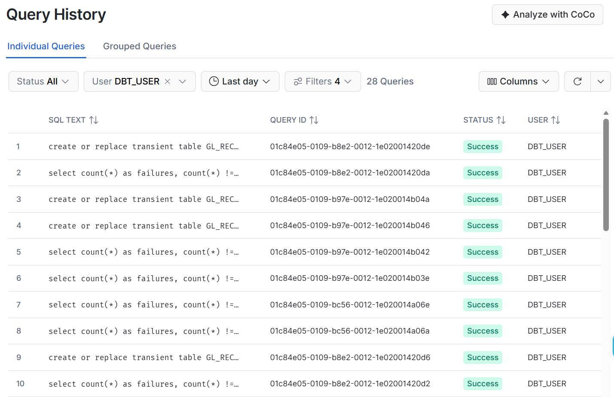
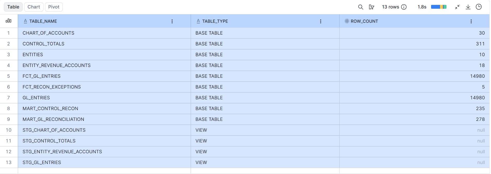
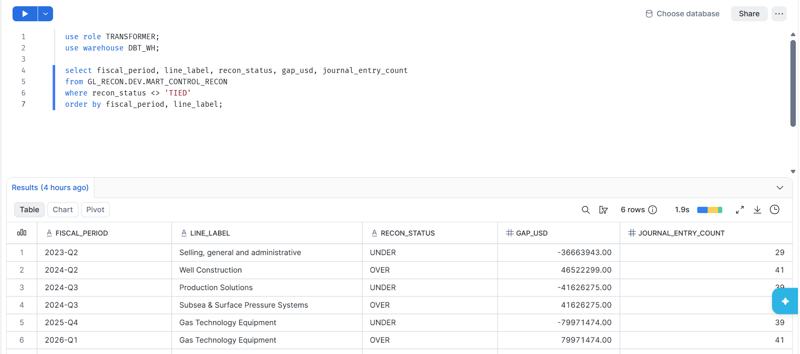

# GL Reconciliation Pipeline — Baker Hughes (BKR)


[](https://github.com/hassanm9301/gl-recon-pipeline/actions/workflows/dbt-ci.yml)

## Overview

A dbt Core project that reconciles a general ledger to a company's **real reported results**,
the way a GL / financial-close team does at quarter end. The same project runs on two targets:
**DuckDB** locally and **Snowflake** in the cloud.

- **Control totals (real):** 311 figures transcribed from Baker Hughes' quarterly earnings releases
  (SEC Form 8-K, Exhibit 99.1), **Q1 2023 through Q3 2026** — revenue by product line, income statement
  lines, and reported totals. Every row carries its `source_url`.
- **GL detail (synthetic):** 7,490 double-entry journal entries (14,980 GL lines) generated by
  `scripts/make_gl_entries.py` so they tie to those control totals exactly.
- **Planted breaks:** four realistic errors are injected on purpose. The reconciliation has to find them.

---

## Business Context

Baker Hughes (NASDAQ: BKR) is a Houston-based energy technology company. Its reporting changed
over the period, and the data keeps each quarter exactly as reported:

| Change | Quarter | Effect in the data |
|---|---|---|
| IET product line reorganization | 2023-Q4 | Condition Monitoring, Inspection, Pumps Valves & Gears, PSI & Controls → Industrial Products, Industrial Solutions, Climate Technology Solutions |
| Income statement format change | 2025-Q1 | Adds R&D and "Other (income) expense, net" lines |
| Chart Industries acquisition | 2026-Q3 | Adds a third segment (Original Equipment, Aftermarket) |

---

## Pipeline Architecture

```
seeds (CSV)
  control_totals (311, real)   gl_entries (14,980, synthetic)   chart_of_accounts (30)   entities (10)
                                                                entity_revenue_accounts (18)
        │                               │                               │
        ▼                               ▼                               ▼
staging (views)
  stg_control_totals           stg_gl_entries                  stg_chart_of_accounts
                                                               stg_entity_revenue_accounts
        │                               │                               │
        │                               ▼                               │
        │                  fct_gl_entries (incremental)                 │
        │                               │                               │
        └───────────────┬───────────────┴───────────────────────────────┘
                        ▼
marts (tables)
  mart_control_recon      GL vs reported, per quarter x P&L line → TIED / OVER / UNDER (±$1M)
  fct_recon_exceptions    journal entries behind each break, classified by error type
  mart_gl_reconciliation  debit/credit balance by quarter, segment, and account type
```

---

## Models

| Model | Layer | Type | Description |
|---|---|---|---|
| `stg_control_totals` | Staging | View | Reported Baker Hughes figures with source links |
| `stg_gl_entries` | Staging | View | Typed GL lines (one debit and one credit line per journal entry) |
| `stg_chart_of_accounts` | Staging | View | Accounts mapped to the control line they roll up to |
| `stg_entity_revenue_accounts` | Staging | View | Which entities are expected to book each revenue account |
| `fct_gl_entries` | Marts | Incremental | Central GL fact; reprocesses only recent entries (see below) |
| `mart_control_recon` | Marts | Table | Reconciliation by quarter and P&L line with gap and status |
| `fct_recon_exceptions` | Marts | Table | Duplicate, cut-off, wrong-account, and missing-entry exceptions |
| `mart_gl_reconciliation` | Marts | Table | Debit/credit balance check by segment and account type |

**Incremental load:** `fct_gl_entries` uses `delete+insert` on `journal_entry_id` with a 7-day
lookback on `entry_date`. A re-posted journal entry replaces all of its lines together, and entries
posted late into an already-loaded period are picked up. `dbt build --full-refresh` rebuilds it from scratch.

**Tolerance:** a line is TIED when the GL is within ±$1M of the reported figure, which covers
rounding in the earnings releases (reported in $ millions).

---

## Results

235 quarter × P&L lines reconciled: **229 TIED, 3 OVER, 3 UNDER.** All six breaks trace to the four
planted errors, and `fct_recon_exceptions` finds each one from the data alone:

| Planted break | Journal entry | How it's detected | Effect |
|---|---|---|---|
| Duplicate entry | JE-2024-Q2-0483 | Same account, entity, date, and amount posted twice | 2024-Q2 Well Construction OVER $46.5M |
| Cut-off error | JE-2025-Q4-0200 | Transaction dated 2025-12-31 but posted to 2026-Q1: the date's quarter doesn't match the posting period | 2025-Q4 Gas Technology Equipment UNDER / 2026-Q1 OVER $80.0M |
| Wrong account | JE-2024-Q3-0089 | BKR-OFSE-NA posted revenue to the Subsea account, which only BKR-OFSE-SUBSEA books (`entity_revenue_accounts`) | 2024-Q3 Production Solutions UNDER / Subsea OVER $41.6M |
| Missing entry | JE-2023-Q2-0472 | Gap in journal entry numbering | 2023-Q2 SG&A UNDER $36.7M |

Detection uses only the structure of the data (posting period vs. transaction date, the
entity-to-account mapping, matching amounts, and JE numbering). The free-text `description`
is never parsed, so the same logic would work on a real ledger.

---

## Data Tests

18 tests: uniqueness and not-null on keys, accepted segment values (OFSE, IET, Chart, Corporate),
referential integrity on the entity-to-account mapping,
a double-entry check that every journal entry's debits equal its credits
(`tests/assert_journal_entries_balance.sql`), and a recon test on `mart_control_recon.recon_status`. The recon test is set to **warn**, so the
planted breaks surface as a warning instead of failing the build.

Latest run, same result on both targets: **30 PASS, 1 WARN (expected), 0 ERROR.**

| Target | Date | Result |
|---|---|---|
| DuckDB (local + CI) | 2026-11-09 | 30 PASS, 1 WARN, 0 ERROR |
| Snowflake (`DEV`) | TODO | TODO |

## Continuous Integration

GitHub Actions (`.github/workflows/dbt-ci.yml`) runs on every push and pull request to `master`:
it installs dbt, runs `dbt build` against a throwaway DuckDB database (`ci/profiles.yml`, no
credentials needed), then runs the incremental model a second time to confirm the incremental
path works. A failing model or test fails the check on the pull request.

---

## How to Run

### Locally on DuckDB (default target)

```bash
venv\Scripts\activate
python scripts/make_gl_entries.py   # optional: regenerate synthetic GL (fixed seed, same output)
dbt build                           # seed, run, and test
```

### On Snowflake

```bash
dbt debug --target snowflake   # check the connection (key-pair auth)
dbt build --target snowflake   # seed, run, and test
```

Snowflake setup: warehouse `DBT_WH` (X-Small, 60-second auto-suspend), database `GL_RECON`,
schema `DEV`, role `TRANSFORMER`, and service user `DBT_USER` with key-pair authentication.
Connection details live in `~/.dbt/profiles.yml` and are not committed to this repo.

---

## Snowflake

The full project (5 seeds, 8 models, 18 tests) runs on Snowflake with no SQL changes; dbt's
cross-database macros (`dbt.dateadd`) handle the dialect differences with DuckDB.

**Dev and prod with zero-copy cloning.** `GL_RECON.DEV` is where dbt builds. Prod is a
zero-copy clone of it, which is created in seconds and uses no extra storage until the two
copies diverge:

```sql
create or replace database GL_RECON_PROD clone GL_RECON;
```

Tested on 2026-11-09: both databases returned 235 rows in `mart_control_recon`. Deleting the
229 TIED rows from the clone left the original at 235, which confirms the copies are independent.

Limitation: the clone's tables are independent copies, but its `stg_` views still read from
`GL_RECON.DEV`, because dbt writes fully qualified names into view definitions. A real prod
environment would be built by dbt with its own `prod` target; the clone is best used as a
snapshot or a quick test environment.

**Cost.** The whole project used **0.35 Snowflake credits** from 2026-10-20 to 2026-11-09: every
dbt run, test and ad-hoc query (`snowflake.account_usage.warehouse_metering_history`).

| Warehouse | Compute | Cloud services | Total |
|---|---|---|---|
| `DBT_WH` (X-Small, 60-second auto-suspend) | 0.3251 | 0.0207 | 0.3458 |
| Cloud services only (clone, metadata) | 0 | 0.0034 | 0.0034 |

0.3251 compute credits is about 20 minutes of X-Small run time over three weeks; auto-suspend
keeps the warehouse off between runs.

**Screenshots**

| | |
|---|---|
|  |  |
| dbt build in Snowflake query history | Seeds, views and tables in `GL_RECON.DEV` |


`mart_control_recon` breaks in Snowflake: the six OVER/UNDER lines from the planted errors.

---

## Data Source

- **Control totals:** Baker Hughes quarterly earnings releases (SEC EDGAR, Form 8-K Exhibit 99.1),
  Q1 2023 – Q3 2026. Each row in `seeds/control_totals.csv` links to its source filing. All quarters
  tie to their reported totals within ±$1M (rounding).
- **GL detail:** synthetic. Entity codes, account codes, and journal entries are made up; product
  line and segment names are real. Generated by `scripts/make_gl_entries.py` (standard library only,
  fixed random seed).

---

## Author

**Muhammad Hassan**
GL Programmer → Analytics Engineering
Houston, TX
GitHub: [@hassanm9301](https://github.com/hassanm9301)
